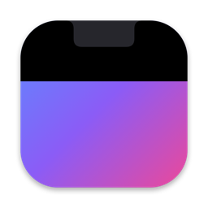

<h1> NotchHider</h1>

A tiny macOS menu bar app that hides the notch by painting a black band at the top of your wallpaper, so the menu bar turns solid black.

- Works on every display: notched screens get a band matching the notch height, other screens get one matching the menu bar height.
- Follows wallpaper, Space, and display changes automatically.
- Restores your original wallpaper when disabled or quit.

## Install

1. **[⬇ Download NotchHider.dmg](https://github.com/vcamaral/NotchHider/releases/latest/download/NotchHider.dmg)** (macOS 13 or later, Apple silicon and Intel).
2. Open the DMG and drag **NotchHider** into **Applications**.
3. Open NotchHider from Applications or Spotlight.

That's it — no Terminal or building needed. If you open the app straight from the DMG, it offers to move itself into Applications.

### First launch

NotchHider isn't notarized by Apple yet, so macOS blocks it the first time. To allow it:

1. Open NotchHider and dismiss the warning.
2. Go to **System Settings › Privacy & Security**, scroll down and click **Open Anyway**.

You only need to do this once.

## Usage

Click the menu bar icon to turn the effect on or off, enable **Launch at Login**, or open **Settings…**. Opening NotchHider again from Spotlight or Finder also brings up the settings window.

To hide the menu bar icon, use **System Settings › Menu Bar** — the settings window has a shortcut to it.

Quitting NotchHider restores your original wallpaper.

## Limitations

- Dynamic (time-of-day) wallpapers become static.
- Apple's animated aerial wallpapers are not supported and are left untouched.

## Building from source

Only needed if you want to change the code. Requires the Xcode Command Line Tools.

```sh
./build.sh                 # builds build/NotchHider.app
./scripts/make-dmg.sh      # builds the app and packages build/NotchHider.dmg
```

The app icon (`scripts/make-icon.swift`) and the DMG background (`scripts/make-dmg-background.swift`) are drawn in code during the build. Generated wallpapers are stored in `~/Library/Application Support/NotchHider/`.

## License

MIT — see [LICENSE](LICENSE).
